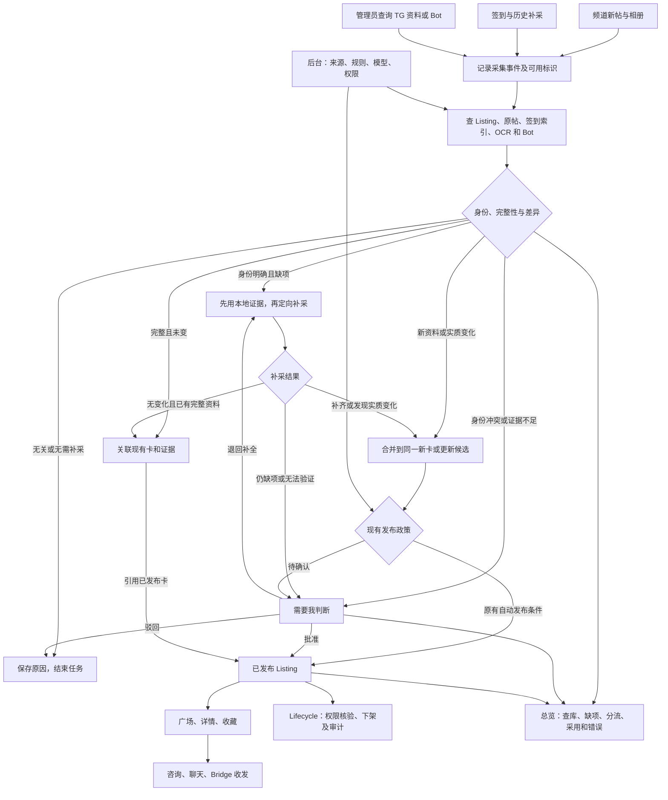

# Nexus V3 采集与审核减负开发清单

2026 年 11 月 18 日 · 供 6.2 Sol 接手、持续开发和统一发布

## 目标与范围

让系统先查库、识别缺项、按需补采。管理员主要处理身份冲突、关键字段变更、证据不足和需要授权的发布或下架动作。同一份资料的签到、规则、OCR、Bot 证据汇入一个审核任务。

复用现有 Core、Bridge、PostgreSQL、资料库、审核页、规则工坊、Vision4、RapidOCR 和模型中心。保留原始证据、人工确认字段、审核权限和现有发布政策。开发期间使用隔离数据，功能齐备后打同一个发布包。旧积压先以分组和折叠方式展示，历史回放、历史 OCR 重跑和批量修改 Listing 均不在本次范围内。

## 已核对的基线

以下为 11 月 18 日生产只读快照，接手先复核分支、镜像、运行模式和队列数量。

| 发现 | 当时的结果 | 开发含义 |
| --- | --- | --- |
| 卡片积压 | 504 张待审、408 张疑似重复，合计 912 张，其中 893 张来自签到补采。近七天生成且仍待处理的 89 张中有 85 张来自签到补采。 | 先改签到入口和重复分流。 |
| 重复候选 | 408 张涉及 140 个标准化 TG 用户名，78 张可按联系人线索匹配已发布卡。 | 用于分组和对比，身份合并仍需可靠证据。 |
| 图片核对 | 202 张图待核对，99 张已关联待审或重复卡。Vision4 预测其中 145 张为人像、47 张为资料卡、10 张为其他。 | 在卡片中呈现证据，模型预测与人工标签分开。 |
| OCR 实际使用 | 近七天 286 条带 Vision4 版本的记录，145 条有结构化字段。来源 2 历史 Active 候选中，1 条携带 OCR 证据、0 条采用 OCR 字段。 | 指标分别统计推理、字段提取、候选采用和审核确认。 |
| Bot 积压 | 100 条有链接未核验，其中 93 条关联已发布卡；另有 28 条未找到链接。 | 区分有无链接、实体类型和归属。 |
| Active 回切 | 当时来源 1、2、5、6 均为 Legacy。11 月 14 日 19:11:56，来源 1、5、6 进入 Shadow 后，Guard 将所有非 Legacy 模式一并回切，原因 `unexpected_active_source`。 | 修正模式兼容性、回切作用范围和后台诊断。 |

## 全站目标流程

## P0 · 先解决重复采集和重复审核

- [x] **N01 盘点真实基线与发布覆盖层。** 核对当前生产 Core、Bridge、PostgreSQL、Guard、Vision4 及实际运行源码。确认正式 Docker 镜像从哪里复制源码、SQL 和前端产物，避免修改只进入工作区或只进入历史发布目录。记录来源模式、规则版本、回滚镜像与现有计数。**验收：** 能说明每项代码从提交进入运行镜像的路径，并可复现隔离环境。
- [ ] **N02 统一查库和分流决策。** 在现有入口复用一套决策逻辑，读取 Listing、已确认人物组、原帖和修订、签到索引及补采结果、OCR 和 Bot。优先按来源与原帖标识定位记录，再用已验证的 Peer ID 或有来源证据的精确 TG 账号查同一身份；昵称和相似文本只作提示。决策输出「直接复用／只补缺项／更新候选／人工判断／结束」及原因、证据引用、缺项、字段差异。完整性使用现有发布校验与来源规则。**验收：** 已发布且完整无变化只引用；待审只补原任务；归档或驳回不会被签到重新上架；身份冲突不会自动归并。
- [ ] **N03 签到补采、历史与实时统一去重。** 先落签到入口。修正当前无指定原帖时「查到非驳回卡就跳过」，以及指定原帖时先查 Telegram 的行为。先查本地原帖和媒体，仅对缺项发起对应查询。实时、历史、签到遇到同来源同原帖同版本复用候选，原帖改版保存差异。跨来源按已确认身份关联证据；价格、联系方式等实质变化走一条更新候选。**验收：** 相同输入从多个入口并发到达、重试或重启均不重复建卡；只有签到或缺资料的记录可查询，达到人工处理条件才出现在待办。可从 `bridge/runner/duty_collection.py`、`bridge/runner/sql/checkin_index_by_username.sql`、`bridge/runner/sql/profile_collection_listing.sql` 起查。
- [ ] **N04 OCR 证据合并与安全回补。** 同一图片复用已有 OCR；对确需处理的新图使用现有模型。按字段保留原值、规范化值、证据位置、版本与来源。人工确认优先，可靠正文保持优先，OCR 补缺项，冲突保留双方。高可信且无冲突的证据预填并默认折叠，支持抽查；身份不明、关键冲突、失败和必要缺项突出显示。延迟 OCR 只更新对应未处理候选，受原帖版本、模式和规则版本约束。**验收：** 多图乱序、重复通知、旧版本晚到、审核后晚到、Active 切回 Legacy 后晚到均保护人工结果和已发布卡；OCR 新候选只能审核，旧自动发布配置开启时也成立。
- [ ] **N05 现有审核工作台增加「需要我判断」。** 先接签到和疑似重复，再挂规则、OCR、Bot 证据；Lifecycle 保留独立权限和动作。按资料分组展示原卡、新候选、原帖和关键差异，支持筛选、补全、批准、驳回、重复核对和审计。身份冲突同组展示，无证据时保留为独立候选。**验收：** 同一业务决定只处理一次，关联 OCR 可从卡片查看，证据不相关的审核动作仍按原权限执行。管理员可在桌面和 390px 操作，旧 URL 可继续使用。

## P1 · 把规则、Bot 和运行状态交给管理员

- [ ] **N06 Bot 前置规则与异常分流。** 复用规则工坊的保存、版本、Dry-run 和启用流程，修复 Bot 规则保存时清空业务配置。先判断卡片是否符合采集条件、是否有可靠 TG 联系方式、是否已有有效结果。继续验证 Telegram 实体类型，分开记录归属证据。明确无 Bot 正常结束，暂时失败按现有账号冷却和有限重试处理，多个候选、归属不明或持续失败进入人工判断。**验收：** 不合格卡、无 TG、近期已有结果都不会新建查询；重复执行不污染既有核验；只有已核验结果可进入现有绑定路径。
- [ ] **N07 补采规则的预览与审核反馈。** 由管理员按来源设置所需字段、允许的补采来源、证据有效期和 Bot 条件。Dry-run 展示拟复用卡、缺哪些项、会否查 Telegram、是否需要审核。从已有人工修正记录提取脱敏改善建议，保留规则版本和原证据关联。**验收：** 草稿和预览不写生产任务；人工确认前不启用规则建议；证据不足时明确显示暂无可靠建议。
- [ ] **N08 修复 Guard 与路由切换保护。** 核对当前 Guard 和受审计切换 API。后台提交前明确说明 Legacy、Shadow、Active 的兼容约束。只有确认 Shadow 不会对业务写入时，才允许其与来源 2 Active 共存；若当前架构不支持，在切换时拒绝并说明。真实越界、心跳断开、急停及运行故障仍执行安全回切。正式长期 Active 保留持久心跳和审计，首页保留最近运行区间及回切原因。**验收：** 普通 Shadow 操作不会无预警回切所有来源；真实故障能回切并审计；NAS 或 Docker 重启后守护可恢复；来源 2 以外的模式只按批准范围改变。
- [ ] **N09 总览显示完整处理链路。** 复用现有数据库和 API，按来源和时间展示原帖、直接复用、只补缺项、新卡、更新、普通未命中、人工任务、发布和异常。详情能查看原文、图片分类、OCR、字段采用、规则版本与审核结果。**验收：** 解释无新消息、无解析、规则未命中、OCR 未采用、Guard 回切各自的原因；统计唯一原帖和业务任务，与图片、版本记录分别计数。模型调用量、字段提取率和人工纠错率标明分母。

## P0 发布门禁 · 同一发布包完成交付

- [ ] **N10 隔离验收。** 用可信生产 Core/Bridge 基底和 PostgreSQL 16.15 验证增量迁移、重复执行和旧镜像读取兼容。覆盖完整卡直接复用、缺一项定向补采、无 TG 不查 Bot、明确无 Bot 正常结束、冲突进人工、重复进入无新卡、异步 OCR 只补证据、Guard 故障回切、已发布卡和 `manual_fields` 保护。用隔离记录走真实 API、Core 和管理员界面，保留回归证据。
- [ ] **N11 构建并统一部署。** 在独立 Git 分支收口，逐项提交，最终形成一个 Git 版本和发布包。按实际生产基底核对候选的源码、镜像和迁移哈希；做好数据库、Compose、旧镜像备份，验证可恢复性；运行现有正式门禁，再进行一次 NAS 发布。保留现有 Vision4 权重和 OCR 引擎。需要改变识别结果的功能须可独立停用，启用范围以发布时的授权和门禁为准。核心故障回滚镜像，保留兼容迁移。
- [ ] **N12 生产验收。** 核对 Core、Bridge、PostgreSQL、Guard、各来源模式和 Listing 状态，用真实管理员会话验收总览、处理链路与工作台，覆盖桌面和 390px。核对正常广场、收藏、聊天、生命周期与模型中心。通过自然到达的事件确认新链路执行；若暂时没有事件，记录验证范围与待观测项。记录 Git commit、发布标签、镜像 ID、备份和回滚位置。

## 接手顺序与验收口径

**顺序：** N01 → N02 → N03 → N04/N05 → N06/N07/N08/N09 → N10–N12。开发过程中更新本清单，记录每项证据、提交和阻断。独立提交便于复核与回退，生产以同一个发布包交付。

**效果指标：** 同一来源和时间窗口对比，每 100 条唯一采集原帖新增几条必须人工处理的任务，同一资料重复进入几个审核入口，多少任务直接复用、多少只补缺项，抽查发现多少错用、漏补和人工纠正。对只提供账号的查询任务单独统计。没有人工核实或可靠证据的候选，保留待确认状态。

## 开发证据

- **N01，11 月 18 日。** 分支 `codex/nexus-collection-reuse-20261118` 从实际 Core 提交 `aed0026195f73d91a9b975d8c987602e913e10a8` 开始。生产 Core `sha256:2aed0efa1004e0bb711c12e1e685db74aa542a46f3658faeea5b592577c3e57b` 和 Bridge `sha256:c43df9f23c54b47ed2b446fee086c0a488514c23f40ea88db50a1bccc258e13a` 是待刷新核验的回滚基线。Bridge 105 个运行 Python/SQL 文件内有四个文件与工作区不同，已按哈希归并 Presence 和发送修复。正式包从 `core/app` 和 `core/frontend/dist` 覆盖 Core 基底；现有入口只部署 Core 和 Guard，N11 须扩展为同包覆盖真实 Bridge 基底。
- **N01，数据与隔离。** 四来源均为 Legacy，来源 2 Guard 心跳正常。来源 1 绑定版本为 9、6、4、7，来源 2 为 1、6、5、7，来源 5 和 6 为 2 和 3。待审 505、疑似重复 411、已发布 172。活动 Vision4 `mobilenetv4-20261108-attested-video-fix` 哈希 `bcce9b51ec7a1008e2126482198cc37d318f2347e374097238fceed6581f6f68`。生产 PostgreSQL 已是 16.16。仓库旧初始化脚本存在列定义顺序缺陷，已在无外部网络的 16.15 容器成功恢复生产 schema-only 导出。隔离验证使用合成数据，发布前另跑生产 16.16 兼容验证。
